<div align="center">

</div>

<div align="center">

[](https://git.io/typing-svg)

</div>

<div align="center">

<a href="https://github.com/zerox-core?tab=followers"></a>
<a href="https://github.com/zerox-core?tab=repositories"></a>
</div>

## 👋 About Me

- 📱 Android 开发者，专注 **Kotlin + Jetpack Compose**，热衷手势驱动的交互 UI 与自定义绘制
- 🤖 AI 工具链构建者，开发过多个 **MCP Server**（飞书本地开发桥、Godot 编辑器桥等）
- 🎮 Godot 引擎探索者
- 🛠️ 信条：真实高于讨好，可验证证据高于主观判断

## 🛠️ Tech Stack

<div align="center">

### Mobile & Languages


### Backend & Data


### DevOps & Tools


</div>

## 📌 置顶项目

<table>
<tr>
<td width="50%" valign="top">

### 🎯 [win_MCP](https://github.com/zerox-core/win_MCP)

**Windows 本地开发 MCP 服务器** — 把你的电脑变成 AI 工作台的受控执行端。

```text
AI 客户端 → HTTPS 隧道 → 你的 MCP → 项目目录与工具链
```

- 受控文件读写、Git 检视、构建/测试执行
- Android / Windows / Node / Python 工具链探测与驱动
- 签名二进制制品导入，目录边界 + 审批 + 审计


</td>
<td width="50%" valign="top">

### 🔍 为什么值得看

不是 demo，而是按真实威胁模型构建的完整实现：

- 双层鉴权（Bearer + PIN），开源代码不含任何真实凭证
- 目录授权引擎：once / session / permanent 三档签名决策
- Windows 管理员代理（named-pipe broker）隔离提权操作
- 900+ 测试用例覆盖安全边界与工具契约

查看 → [仓库](https://github.com/zerox-core/win_MCP) · [安全说明](https://github.com/zerox-core/win_MCP/blob/main/SECURITY.md)

</td>
</tr>
</table>

---

## 📊 GitHub Statistics

<div align="center">


</div>

<div align="center">

</div>

## 🐍 Contribution Snake

*蛇走过的贡献格会被吃掉，然后按被吃顺序约 15 秒后渐变恢复*

<div align="center">

</div>

## 💡 Areas of Interest

<div align="center">


</div>

## 🤝 Connect With Me

<div align="center">
<a href="mailto:zhuxice@gmail.com"></a>
<a href="https://zeroxcore.tech/"></a>
</div>

<div align="center">

### "真实高于讨好，完成结果高于表面进度。"


</div>
